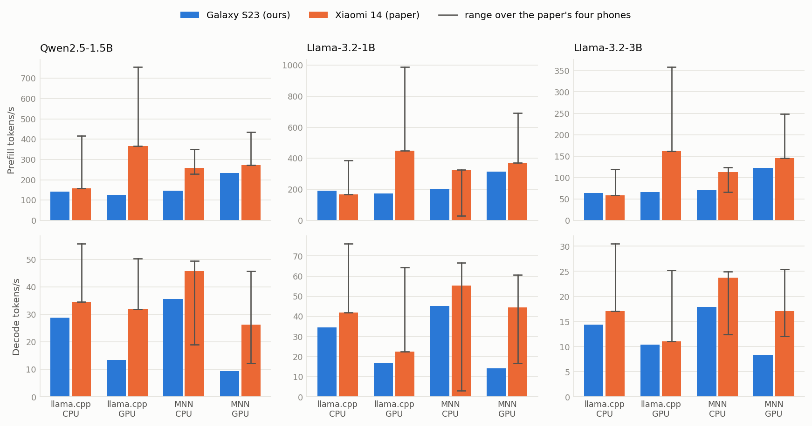
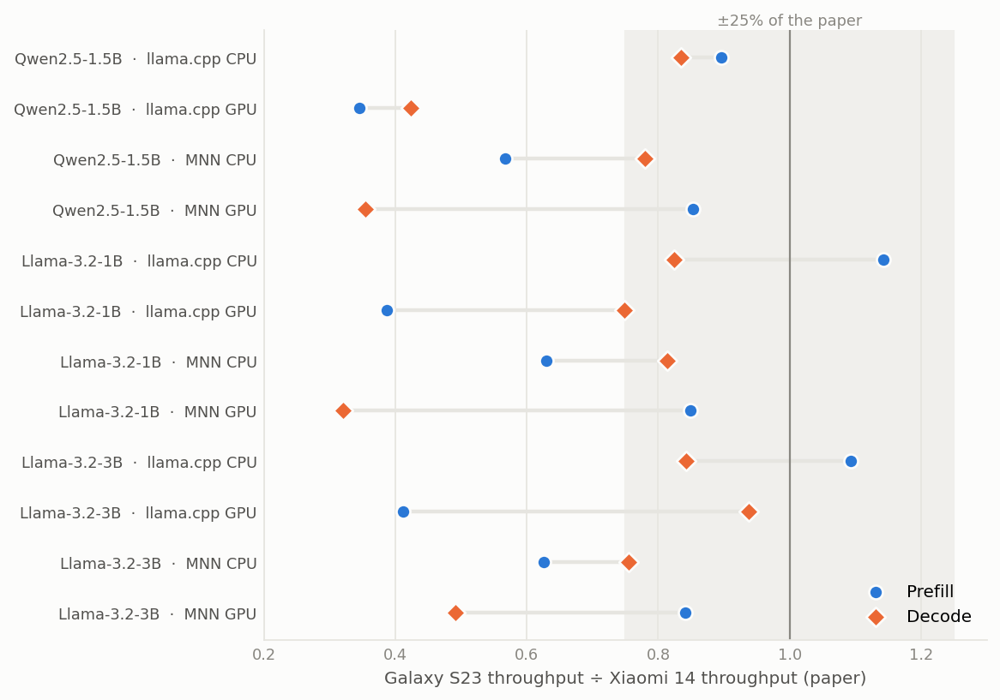
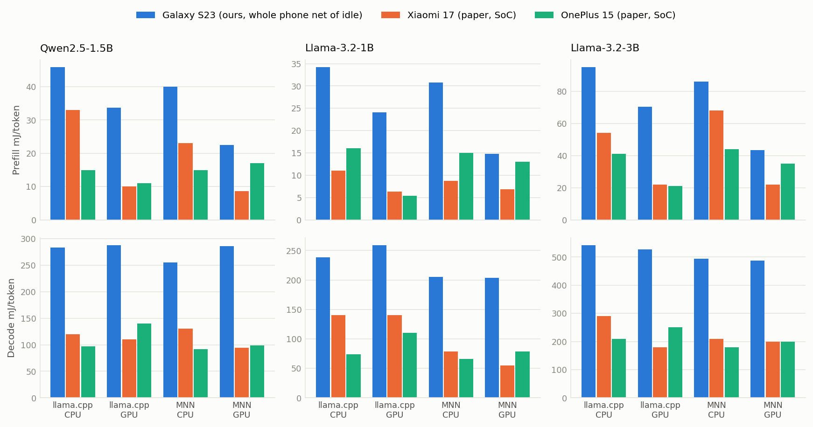
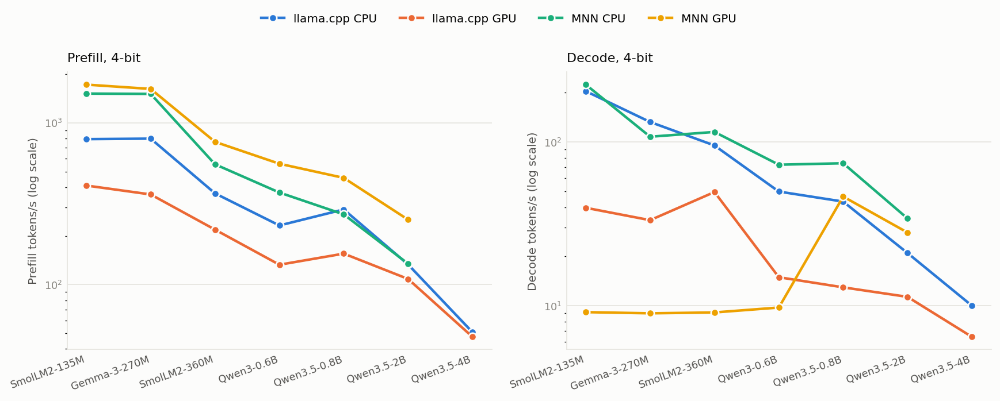
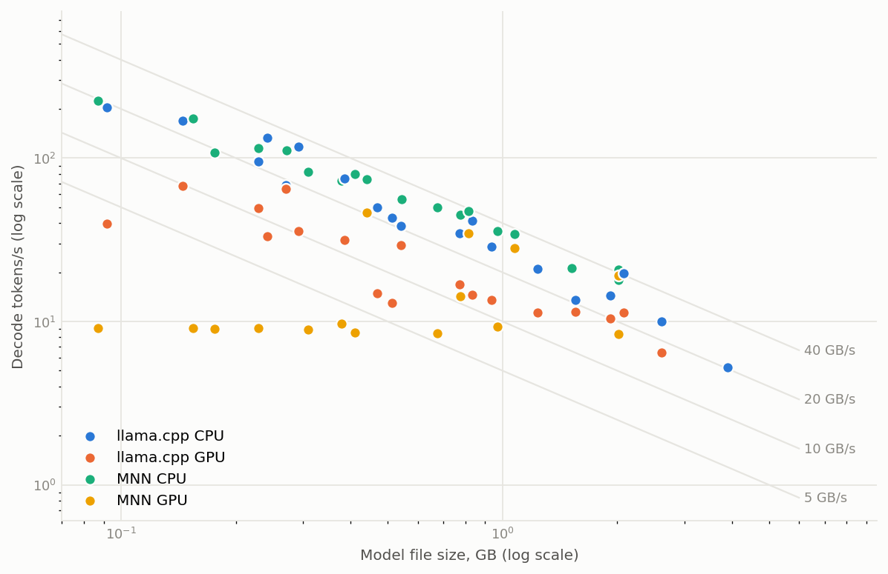
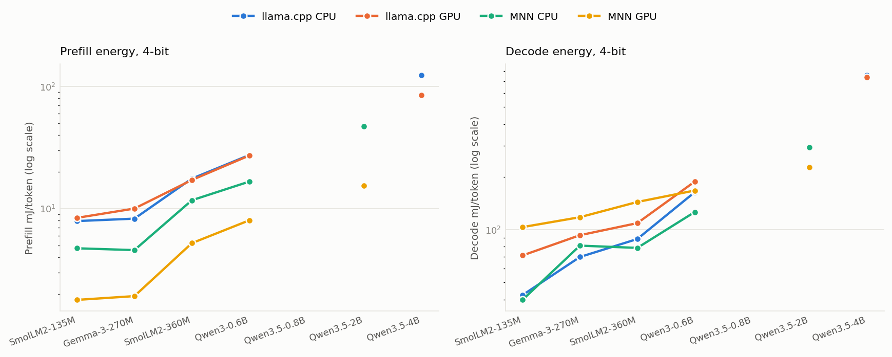
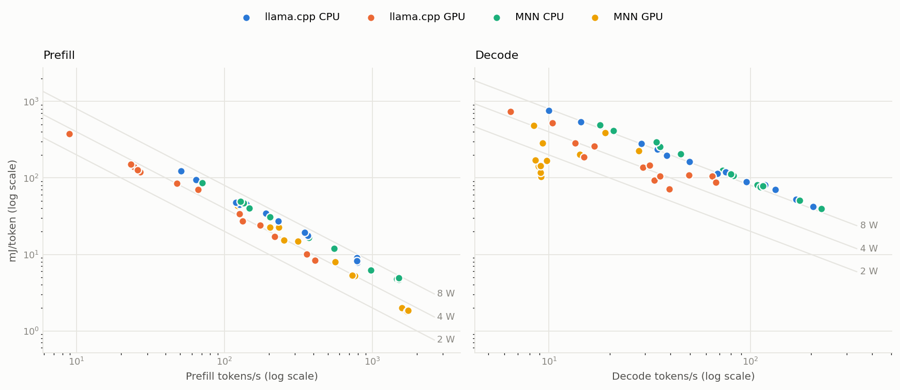

# Galaxy S23 results in the paper's Table 5 layout

Generated 2026-10-10T17:00 by `Benchmark-Harness/paper_table5/results2.py`. Reference: arXiv 2607.05475, Table 5: 256-token prefill and 256-token decode; throughput in tokens/s, energy in µJ/token.

- **Phone:** Galaxy S23 (Snapdragon 8 Gen 2, Adreno 740, 8 GB), unrooted, on battery, airplane mode with Wi-Fi kept for adb, screen off, every run started at ≤ 28 °C.
- **Runs:** 1 warm-up + 3 recorded repetitions (mean ± std); llama.cpp CPU with 4 threads; MNN decode timed on the wall clock.
- **S23 energy** is whole-phone battery energy net of idle; the paper's is SoC-only, reported for the Xiaomi 17 and OnePlus 15. They are not the same quantity; see [RESULTS.md](RESULTS.md) for the protocol differences and [DEBUG.md](DEBUG.md) for the audit.

## 1. The paper's models: S23 next to the paper's four phones

### Throughput (tokens/s), 4-bit

| Model | Backend | Framework | Prefill S23 | X17 | OP15 | X15 | X14 | Decode S23 | X17 | OP15 | X15 | X14 |
|---|---|---|--:|--:|--:|--:|--:|--:|--:|--:|--:|--:|
| Qwen2.5-1.5B | CPU | llama.cpp | 140.7 ± 1.3 | 417.3 | 299.9 | 329.2 | 157.2 | 28.8 ± 0.5 | 51.6 | 55.7 | 53.9 | 34.5 |
|  | CPU | MNN | 147.1 ± 5.0 | 349.5 | 228.3 | 259.4 | 259.5 | 35.6 ± 0.2 | 19.0 | 47.5 | 49.5 | 45.7 |
|  | GPU | llama.cpp | 126.2 ± 0.1 | 569.7 | 754.8 | 680.9 | 365.7 | 13.5 ± 0.2 | 38.8 | 50.3 | 48.6 | 31.8 |
|  | GPU | MNN | 232.3 ± 1.7 | 392.2 | 434.1 | 406.1 | 272.5 | 9.3 ± 0.3 | 39.1 | 12.3 | 45.8 | 26.2 |
| Llama-3.2-1B | CPU | llama.cpp | 190.1 ± 2.2 | 326.8 | 287.6 | 386.3 | 166.3 | 34.6 ± 0.6 | 76.1 | 72.2 | 70.1 | 41.9 |
|  | CPU | MNN | 202.7 ± 7.0 | 29.8 | 184.8 | 324.8 | 321.9 | 45.1 ± 0.3 | 3.2 | 61.6 | 66.6 | 55.4 |
|  | GPU | llama.cpp | 174.4 ± 0.3 | 744.0 | 986.8 | 862.1 | 450.1 | 16.8 ± 0.2 | 46.1 | 64.4 | 57.1 | 22.5 |
|  | GPU | MNN | 315.3 ± 0.2 | 692.1 | 669.8 | 534.4 | 371.3 | 14.2 ± 0.2 | 16.8 | 21.6 | 60.7 | 44.4 |
| Llama-3.2-3B | CPU | llama.cpp | 64.0 ± 0.4 | 119.7 | 109.8 | 114.8 | 58.6 | 14.4 ± 0.3 | 29.9 | 30.5 | 27.1 | 17.1 |
|  | CPU | MNN | 70.9 ± 2.2 | 123.4 | 66.1 | 90.8 | 113.1 | 17.9 ± 0.1 | 12.4 | 24.9 | 24.0 | 23.7 |
|  | GPU | llama.cpp | 66.3 ± 0.1 | 224.8 | 357.6 | 306.6 | 161.1 | 10.4 ± 0.1 | 20.0 | 25.0 | 25.2 | 11.1 |
|  | GPU | MNN | 122.2 ± 0.1 | 201.2 | 248.7 | 205.3 | 145.3 | 8.4 ± 0.1 | 24.4 | 12.1 | 25.4 | 17.1 |

X17 = Xiaomi 17, OP15 = OnePlus 15, X15 = Xiaomi 15, X14 = Xiaomi 14 (paper values). Qwen2.5-7B is not shown: it does not fit in the S23's 8 GB of RAM.

### Energy (µJ/token), 4-bit

| Model | Backend | Framework | Prefill S23 | X17 | OP15 | Decode S23 | X17 | OP15 |
|---|---|---|--:|--:|--:|--:|--:|--:|
| Qwen2.5-1.5B | CPU | llama.cpp | 4.6e4 | 3.3e4 | 1.5e4 | 2.8e5 | 1.2e5 | 9.7e4 |
|  | CPU | MNN | 4.0e4 | 2.3e4 | 1.5e4 | 2.6e5 | 1.3e5 | 9.2e4 |
|  | GPU | llama.cpp | 3.4e4 | 1.0e4 | 1.1e4 | 2.9e5 | 1.1e5 | 1.4e5 |
|  | GPU | MNN | 2.3e4 | 8.6e3 | 1.7e4 | 2.9e5 | 9.4e4 | 9.9e4 |
| Llama-3.2-1B | CPU | llama.cpp | 3.4e4 | 1.1e4 | 1.6e4 | 2.4e5 | 1.4e5 | 7.4e4 |
|  | CPU | MNN | 3.1e4 | 8.7e3 | 1.5e4 | 2.1e5 | 7.9e4 | 6.6e4 |
|  | GPU | llama.cpp | 2.4e4 | 6.3e3 | 5.4e3 | 2.6e5 | 1.4e5 | 1.1e5 |
|  | GPU | MNN | 1.5e4 | 6.9e3 | 1.3e4 | 2.0e5 | 5.5e4 | 7.9e4 |
| Llama-3.2-3B | CPU | llama.cpp | 9.5e4 | 5.4e4 | 4.1e4 | 5.4e5 | 2.9e5 | 2.1e5 |
|  | CPU | MNN | 8.6e4 | 6.8e4 | 4.4e4 | 4.9e5 | 2.1e5 | 1.8e5 |
|  | GPU | llama.cpp | 7.0e4 | 2.2e4 | 2.1e4 | 5.3e5 | 1.8e5 | 2.5e5 |
|  | GPU | MNN | 4.3e4 | 2.2e4 | 3.5e4 | 4.9e5 | 2.0e5 | 2.0e5 |

## 2. How the S23 compares with the paper

*Prefill (top) and decode (bottom) throughput per framework and backend. Blue: Galaxy S23. Orange: the paper's Xiaomi 14, the closest phone (one chip generation newer). The dark bracket is the range over the paper's four phones.*

*Each row is one configuration; a point at 1.0 means the S23 matches the Xiaomi 14. The shaded band is ±25%.*

- **13 of 24 throughput cells are within ±25% of the Xiaomi 14.**
- **CPU is close.** llama.cpp CPU: median ratio 1.09 for prefill and 0.84 for decode. MNN CPU: 0.63 and 0.78; MNN's CPU prefill trails more than one chip generation explains.
- **llama.cpp GPU prefill is the largest gap** (median ratio 0.39): on the S23's Adreno 740 it is no faster than the CPU, while the paper's GPUs are 2–3× faster than their CPUs. MNN GPU prefill holds up (median 0.85).
- **GPU decode is slower than CPU decode on the S23 and on the paper's Xiaomi 14 alike.** S23 GPU decode ratios: llama.cpp 0.75, MNN 0.35 (the paper's MNN version does not batch OpenCL commands during decode, which costs ~3–4 ms per layer per token).

*Energy per token, in mJ/token (1 mJ = 1000 µJ). Blue: S23, whole phone net of idle. Orange and aqua: the paper's SoC-only values.*

- **S23 energy per token is 1.5–4.1× the paper's** (median 2.4× the mean of its two phones). Two things multiply: those phones are a median 2.0× faster, and the S23's measured power is a median 1.1× theirs (energy per token × tokens per second). The S23 figure is whole-phone power, which includes memory, storage and regulator losses that SoC counters leave out.
- **The patterns match the paper:** decode costs several times more per token than prefill; GPU prefill is cheaper per token than CPU prefill; GPU decode saves nothing over CPU decode.
- Absolute S23 energy carries roughly ±10–20% uncertainty from the battery gauge; comparisons between S23 configurations do not.

## 3. SLM_Factory model pool on the S23

Pool: `config/android_pool.py` on SLM_Factory `main`. Qwen3, SmolLM2 and Gemma 3 run on the paper's llama.cpp `eadc418` / MNN `510ac8f`; Qwen3.5 needs newer versions (llama.cpp `9c2e0e4`, MNN `a8ec497`, text decoder only). Quantizations: llama.cpp Q4_0 / Q8_0 / F16, MNN 4 / 8 / 16-bit.

| Model | Backend | Framework | Quant. | Prefill t/s | Prefill µJ/token | Decode t/s | Decode µJ/token |
|---|---|---|---|--:|--:|--:|--:|
| SmolLM2-135M | CPU | llama.cpp | Q4_0 | 793.4 ± 0.3 | 7.9e3 | 204.5 ± 1.5 | 4.2e4 |
|  | CPU | MNN | Q4 | 1518.0 ± 6.4 | 4.7e3 | 224.3 ± 1.7 | 4.0e4 |
|  | GPU | llama.cpp | Q4_0 | 409.7 ± 1.7 | 8.4e3 | 39.6 ± 0.5 | 7.1e4 |
|  | GPU | MNN | Q4 | 1725.1 ± 97.8 | 1.8e3 | 9.1 ± 0.1 | 1.0e5 |
|  | CPU | llama.cpp | Q8_0 | 786.1 ± 0.2 | 8.2e3 | 168.6 ± 1.7 | 5.2e4 |
|  | CPU | MNN | Q8 | 1508.5 ± 73.7 | 5.0e3 | 174.9 ± 5.0 | 5.1e4 |
|  | GPU | llama.cpp | Q8_0 | 25.8 ± 0.0 | 1.3e5 | 67.3 ± 3.1 | 8.7e4 |
|  | GPU | MNN | Q8 | 1753.2 ± 18.2 | 1.9e3 | 9.1 ± 0.1 | 1.2e5 |
|  | CPU | llama.cpp | F16 | 119.7 ± 0.0 | 4.7e4 | 68.5 ± 1.5 | 1.1e5 |
|  | CPU | MNN | F16 | 976.4 ± 159.6 | 6.2e3 | 111.8 ± 4.8 | 7.6e4 |
|  | GPU | llama.cpp | F16 | 23.3 ± 0.0 | 1.5e5 | 64.7 ± 2.3 | 1.1e5 |
|  | GPU | MNN | F16 | FAIL | FAIL | FAIL | FAIL |
| Gemma-3-270M | CPU | llama.cpp | Q4_0 | 799.2 ± 0.1 | 8.3e3 | 132.5 ± 2.8 | 7.0e4 |
|  | CPU | MNN | Q4 | 1510.8 ± 147.8 | 4.6e3 | 107.7 ± 2.2 | 8.1e4 |
|  | GPU | llama.cpp | Q4_0 | 360.8 ± 5.4 | 1.0e4 | 33.3 ± 1.9 | 9.3e4 |
|  | GPU | MNN | Q4 | 1622.0 ± 7.5 | 1.9e3 | 9.0 ± 0.1 | 1.2e5 |
|  | CPU | llama.cpp | Q8_0 | 790.2 ± 0.1 | 9.0e3 | 117.8 ± 1.4 | 8.1e4 |
|  | CPU | MNN | Q8 | 1465.2 ± 127.9 | 4.8e3 | 82.2 ± 1.5 | 1.1e5 |
|  | GPU | llama.cpp | Q8_0 | 26.8 ± 0.1 | 1.2e5 | 35.6 ± 0.5 | 1.1e5 |
|  | GPU | MNN | Q8 | 1588.5 ± 6.6 | 2.0e3 | 8.9 ± 0.1 | 1.4e5 |
|  | CPU | llama.cpp | F16 | 126.7 ± 0.0 | 4.5e4 | 38.4 ± 0.7 | 2.0e5 |
|  | CPU | MNN | F16 | 1082.3 ± 43.3 | – | 56.2 ± 1.7 | – |
|  | GPU | llama.cpp | F16 | 24.4 ± 0.0 | 1.4e5 | 29.3 ± 0.9 | 1.4e5 |
|  | GPU | MNN | F16 | FAIL | FAIL | FAIL | FAIL |
| SmolLM2-360M | CPU | llama.cpp | Q4_0 | 366.4 ± 4.1 | 1.8e4 | 95.2 ± 2.6 | 8.9e4 |
|  | CPU | MNN | Q4 | 554.2 ± 44.3 | 1.2e4 | 115.2 ± 1.4 | 7.9e4 |
|  | GPU | llama.cpp | Q4_0 | 218.6 ± 0.6 | 1.7e4 | 49.5 ± 3.1 | 1.1e5 |
|  | GPU | MNN | Q4 | 763.1 ± 5.8 | 5.2e3 | 9.1 ± 1.1 | 1.4e5 |
|  | CPU | llama.cpp | Q8_0 | 348.1 ± 7.2 | 1.9e4 | 75.2 ± 1.0 | 1.2e5 |
|  | CPU | MNN | Q8 | 553.0 ± 37.0 | 1.2e4 | 79.9 ± 0.9 | 1.1e5 |
|  | GPU | llama.cpp | Q8_0 | 8.9 ± 0.0 | 3.8e5 | 31.6 ± 0.4 | 1.5e5 |
|  | GPU | MNN | Q8 | 734.8 ± 4.1 | 5.3e3 | 8.6 ± 0.3 | 1.7e5 |
| Qwen3-0.6B | CPU | llama.cpp | Q4_0 | 232.0 ± 2.0 | 2.7e4 | 49.8 ± 1.1 | 1.6e5 |
|  | CPU | MNN | Q4 | 370.8 ± 17.7 | 1.7e4 | 72.7 ± 0.8 | 1.3e5 |
|  | GPU | llama.cpp | Q4_0 | 132.6 ± 0.2 | 2.7e4 | 14.9 ± 0.0 | 1.9e5 |
|  | GPU | MNN | Q4 | 558.9 ± 1.4 | 8.0e3 | 9.7 ± 1.3 | 1.7e5 |
|  | CPU | MNN | Q8 | 368.0 ± 14.0 | – | 49.8 ± 0.3 | – |
|  | GPU | MNN | Q8 | 539.7 ± 1.6 | – | 8.4 ± 0.1 | – |
| Qwen3.5-0.8B | CPU | llama.cpp | Q4_0 | 291.4 ± 5.8 | – | 43.2 ± 0.9 | – |
|  | CPU | MNN | Q4 | 271.6 ± 9.3 | – | 74.2 ± 0.4 | – |
|  | GPU | llama.cpp | Q4_0 | 155.3 ± 2.0 | – | 12.9 ± 0.1 | – |
|  | GPU | MNN | Q4 | 456.9 ± 5.8 | – | 46.4 ± 0.1 | – |
|  | CPU | llama.cpp | Q8_0 | 261.7 ± 3.5 | – | 41.3 ± 0.3 | – |
|  | CPU | MNN | Q8 | 274.6 ± 8.6 | – | 47.4 ± 0.3 | – |
|  | GPU | llama.cpp | Q8_0 | 163.0 ± 1.8 | – | 14.6 ± 0.1 | – |
|  | GPU | MNN | Q8 | 379.2 ± 5.9 | – | 34.7 ± 0.2 | – |
|  | CPU | llama.cpp | F16 | 26.6 ± 0.3 | – | 13.5 ± 0.2 | – |
|  | CPU | MNN | F16 | 215.9 ± 5.0 | – | 21.3 ± 1.8 | – |
|  | GPU | llama.cpp | F16 | 160.7 ± 1.5 | – | 11.5 ± 0.0 | – |
|  | GPU | MNN | F16 | FAIL | FAIL | FAIL | FAIL |
| Qwen3.5-2B | CPU | llama.cpp | Q4_0 | 133.0 ± 1.2 | – | 21.0 ± 0.3 | – |
|  | CPU | MNN | Q4 | 134.4 ± 3.5 | 4.7e4 | 34.1 ± 0.6 | 3.0e5 |
|  | GPU | llama.cpp | Q4_0 | 108.3 ± 1.2 | – | 11.3 ± 0.1 | – |
|  | GPU | MNN | Q4 | 251.9 ± 2.6 | 1.5e4 | 28.0 ± 0.1 | 2.3e5 |
|  | CPU | llama.cpp | Q8_0 | 120.0 ± 0.9 | – | 19.8 ± 0.2 | – |
|  | CPU | MNN | Q8 | 128.1 ± 1.6 | 5.0e4 | 20.9 ± 0.1 | 4.2e5 |
|  | GPU | llama.cpp | Q8_0 | 113.0 ± 0.6 | – | 11.3 ± 0.0 | – |
|  | GPU | MNN | Q8 | 203.1 ± 3.9 | 2.3e4 | 19.0 ± 0.0 | 3.9e5 |
|  | CPU | llama.cpp | F16 | 9.3 ± 0.1 | – | 5.3 ± 0.3 | – |
|  | CPU | MNN | F16 | FAIL | FAIL | FAIL | FAIL |
|  | GPU | llama.cpp | F16 | FAIL | FAIL | FAIL | FAIL |
|  | GPU | MNN | F16 | FAIL | FAIL | FAIL | FAIL |
| Qwen3.5-4B | CPU | llama.cpp | Q4_0 | 50.8 ± 1.5 | 1.2e5 | 10.0 ± 0.2 | 7.6e5 |
|  | GPU | llama.cpp | Q4_0 | 47.5 ± 0.3 | 8.5e4 | 6.5 ± 0.0 | 7.4e5 |
|  | CPU | llama.cpp | Q8_0 | FAIL | FAIL | FAIL | FAIL |
|  | GPU | llama.cpp | Q8_0 | FAIL | FAIL | FAIL | FAIL |
|  | CPU | llama.cpp | F16 | FAIL | FAIL | FAIL | FAIL |
|  | CPU | MNN | F16 | FAIL | FAIL | FAIL | FAIL |
|  | GPU | llama.cpp | F16 | FAIL | FAIL | FAIL | FAIL |
|  | GPU | MNN | F16 | FAIL | FAIL | FAIL | FAIL |

58 configurations measured, 12 could not run. `–` in an energy column = throughput measured, energy not yet: 16 rows lost their battery trace when the phone reset and are queued to rerun; 3 rows of the latest session get theirs from its battery trace, which is still on the phone. Models and configurations still to run are not listed yet.

**Treat with caution:** `smollm2-135m__Q8_0__llama.cpp__gpu`, `smollm2-135m__F16__llama.cpp__gpu`, `gemma3-270m__Q8_0__llama.cpp__gpu`, `gemma3-270m__F16__llama.cpp__gpu`, `smollm2-360m__Q8_0__llama.cpp__gpu` — prefill is slower than decode. All are llama.cpp GPU rows with Q8_0 or F16 weights on the paper's llama.cpp `eadc418`; the same weight types on the newer llama.cpp (the Qwen3.5 rows) do not show it, so this looks like a slow OpenCL prefill path in that version for these models. Not yet confirmed; do not cite these prefill numbers.

*4-bit throughput by model, smallest to largest (log scale). One line per framework and backend; a gap means that configuration has not run yet. Qwen3.5 uses newer llama.cpp and MNN versions than the smaller models, so its points are not strictly comparable with theirs (MNN GPU decode in particular is much faster in the newer MNN).*

*Every measured configuration: decode speed against model file size. Decode reads all weights once per token, so points on a grey line share the same effective memory bandwidth. CPU runs follow the 20–40 GB/s lines; GPU runs fall below them, most of all for small models, where per-token overhead dominates.*

## 4. Energy report

51 configurations have valid energy so far (the Table 5 models plus the pool rows above). All S23 energy is whole-phone battery energy during the timed work minus the idle power measured just before it.

*4-bit energy per token by model, smallest to largest (log scale). A gap means that configuration has no energy yet.*

*Every configuration with energy: energy per token against speed. Energy per token = power ÷ speed, so points on a grey line draw the same net power; lower right is better.*

### Net power while running (W above idle)

| Backend | Framework | Prefill W | Decode W | Configurations |
|---|---|--:|--:|--:|
| CPU | llama.cpp | 5.7–7.1 (median 6.4) | 7.5–9.5 (median 8.3) | 13 |
| CPU | MNN | 5.9–7.5 (median 6.4) | 8.5–10.1 (median 8.9) | 13 |
| GPU | llama.cpp | 3.2–4.7 (median 3.6) | 2.8–6.9 (median 4.4) | 13 |
| GPU | MNN | 3.1–5.3 (median 3.9) | 0.9–7.4 (median 1.5) | 12 |

- **Energy per token is set by speed far more than by power.** Net power stays between about 1 and 10 W across every configuration, while speed spans more than two orders of magnitude, so the slow configurations are the expensive ones.
- **Decode costs several times more per token than prefill** (the one exception is the flagged SmolLM2-135M Q8_0 llama.cpp GPU row): prefill processes 256 tokens in one batched pass, decode makes one pass per token.
- **MNN GPU prefill is the cheapest way to process a prompt:** it is faster than the CPU and draws less power. llama.cpp GPU prefill also draws less power but is slower than the CPU on this phone, so its energy per token is about the same as the CPU's for the smallest models and lower for the 1B+ models.
- **GPU decode draws less power but is so slow** that its energy per token is no better than the CPU's, and for the smallest models it is the most expensive option.
- **Cheapest 4-bit configuration per model** (models with all four measured): SmolLM2-135M: prefill MNN GPU (1.8e3 µJ/token), decode MNN CPU (4.0e4 µJ/token); Gemma-3-270M: prefill MNN GPU (1.9e3 µJ/token), decode llama.cpp CPU (7.0e4 µJ/token); SmolLM2-360M: prefill MNN GPU (5.2e3 µJ/token), decode MNN CPU (7.9e4 µJ/token); Qwen3-0.6B: prefill MNN GPU (8.0e3 µJ/token), decode MNN CPU (1.3e5 µJ/token).
- Energy for the current session's rows comes from a snapshot of the battery trace taken while the session is still running; the harness recomputes nothing for them at session end, and the values do not change.

### Configurations that could not run

- `gemma3-270m__F16__mnn__gpu`: crash/error (exit 139): PB_MARK mnn mode=kv rep=0 begin=10913140989802 end=10947887862549 prefill_us=4031952 decode_us=30195704 prompt=256 gen=256 | Segmentation fault
- `qwen3.5-0.8b__F16__mnn__gpu__head`: crash/error (exit 139): [llm_bench] -kv true is deprecated: use `-pg <pp>,<tg>` instead (`-p A -n B -kv true` == `-pg A,B`). | PB_MARK mnn mode=kv rep=0 begin=335112369169331 end=335138592140363 prefill_us=8440179 decode_us=17037351 prompt=256 gen=256 | Segmentation fault
- `qwen3.5-2b__F16__llama.cpp__gpu__head`: crash/error (exit 1): llama_model_load: error loading model: unable to allocate OpenCL buffer | llama_model_load_from_file_impl: failed to load model | llama_bench: error: failed to load model '/data/local/tmp/paper_bench/models/qwen3.5-2b-f16-head.gguf'
- `qwen3.5-2b__F16__mnn__cpu__head`: does not fit in RAM: 3877 MB of the benchmark process was swapped out (stopped at > 512 MB)
- `qwen3.5-2b__F16__mnn__gpu__head`: does not fit in RAM: 7.04 GiB of weights in memory on a phone with 6.91 GiB RAM (limit 75%); not run
- `qwen3.5-4b__F16__llama.cpp__cpu__head`: does not fit in RAM: 8.07 GiB of weights in memory on a phone with 6.91 GiB RAM (limit 75%); not run
- `qwen3.5-4b__F16__llama.cpp__gpu__head`: does not fit in RAM: 8.07 GiB of weights in memory on a phone with 6.91 GiB RAM (limit 75%); not run
- `qwen3.5-4b__F16__mnn__cpu__head`: does not fit in RAM: 15.71 GiB of weights in memory on a phone with 6.91 GiB RAM (limit 75%); not run
- `qwen3.5-4b__F16__mnn__gpu__head`: does not fit in RAM: 15.71 GiB of weights in memory on a phone with 6.91 GiB RAM (limit 75%); not run
- `qwen3.5-4b__Q8_0__llama.cpp__cpu__head`: does not fit in RAM: 600 MB of the benchmark process was swapped out (stopped at > 512 MB)
- `qwen3.5-4b__Q8_0__llama.cpp__gpu__head`: does not fit in RAM: 723 MB of the benchmark process was swapped out (stopped at > 512 MB)
- `smollm2-135m__F16__mnn__gpu`: crash/error (exit 139): PB_MARK mnn mode=kv rep=0 begin=9816338135689 end=9844742111147 prefill_us=1284417 decode_us=27019068 prompt=256 gen=256 | Segmentation fault
